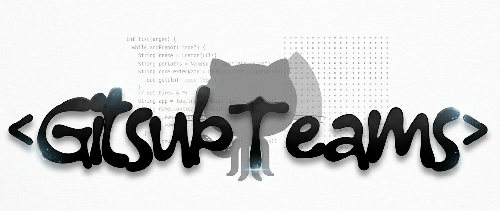

<header>
  

    
  

</header>

# Gitsub Teams OG

**Membangun solusi perangkat lunak modern — dari desain, pengembangan, hingga deployment.**

Kami adalah tim pengembang yang berfokus pada pembuatan aplikasi web dan mobile yang bersih, cepat, dan mudah digunakan.

###

## Overview

Gitsub Teams OG adalah organisasi pengembangan perangkat lunak yang berkolaborasi untuk membangun berbagai produk digital. Salah satu proyek unggulan kami adalah **8BallBooking**, sebuah sistem booking berbasis web dengan backend dan frontend terpisah.

- **Fokus:** aplikasi web full-stack, sistem booking, dan antarmuka pengguna yang responsif.
- **Pendekatan:** kolaborasi tim, kode yang rapi, dan alur kerja Git yang terstruktur.
- **Tujuan:** menghadirkan produk yang andal, skalabel, dan mudah dipelihara.

## Tech Stack

### Bahasa Pemrograman

  
  
  
  
  
  

### Tools & Teknologi

  
  
  
  
  
  
  
  
  
  
  

## Penutup

Terima kasih telah berkunjung ke organisasi kami. Kami percaya bahwa kolaborasi dan konsistensi adalah kunci dalam membangun perangkat lunak yang bermanfaat. Jika Anda tertarik untuk berkolaborasi atau berbagi ide, jangan ragu untuk menghubungi kami melalui GitHub.

  

  

 

    © 2026 Gitsub Teams OG. Seluruh hak cipta dilindungi.

